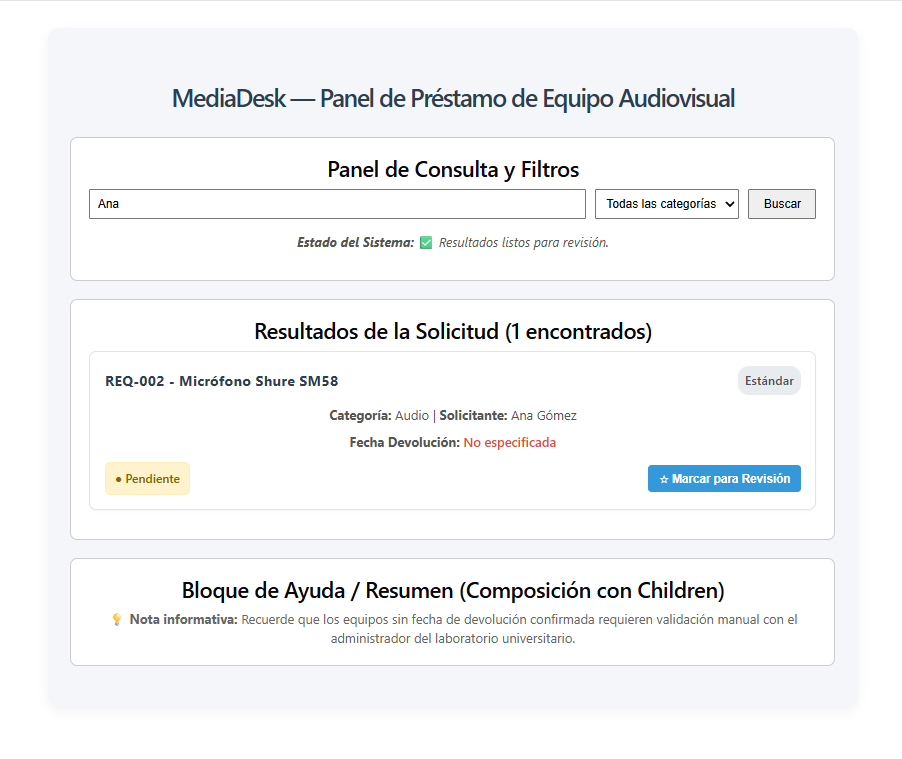
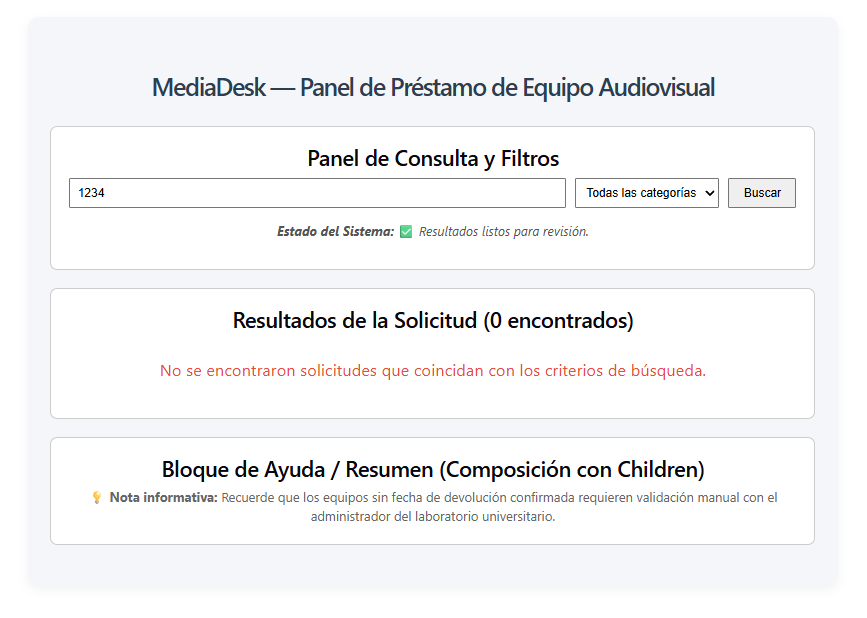
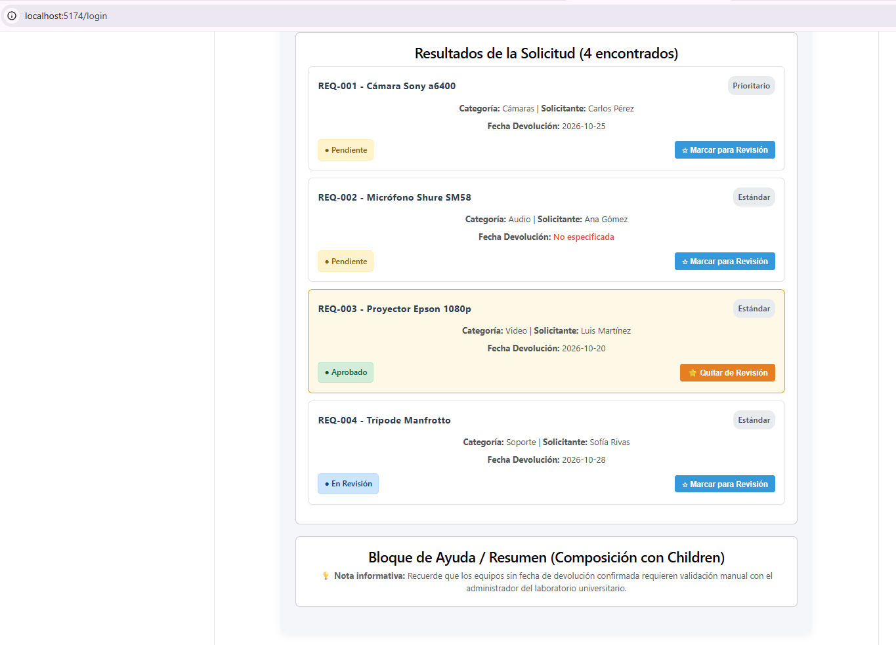
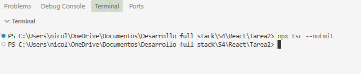

# MediaDesk - Panel de Préstamo de Equipo Audiovisual

## 1. Objetivo del Proyecto
Desarrollar una interfaz en React y TypeScript para registrar y revisar solicitudes de préstamo de equipo audiovisual de un laboratorio universitario, aplicando contratos explícitos, props opcionales con valores predeterminados, eventos del DOM fuertemente tipados y composición avanzada mediante `children` y funciones hijas (Render Props).

## 2. Requisitos Previos y Entorno
- Node.js instalado (versión 18 o superior recomendada).
- Gestor de paquetes npm.

## 3. Instalación y Ejecución
1. Clonar o descomprimir el repositorio del proyecto.
2. Abrir la terminal en la carpeta raíz del proyecto y ejecutar la instalación de dependencias:
   ```bash
   npm install

## 4. Validación de Escenarios Principales
- **Consulta con coincidencias:** Permite verificar el filtrado reactivo de tarjetas y el contador.
- **Búsqueda sin coincidencias:** Comprueba el mensaje de control cuando no existen registros.
- **Marcar para revisión:** Valida la alteración del estado visual y los colores sin mutar el objeto original.

## 5. Evidencia 
### A. Consulta con Resultados ("Ana")


### B. Búsqueda sin Coincidencias ("1234")


### C. Solicitud Marcada para Revisión


### D. Tsc --noEmit


## 6. Explicación de Decisiones Conceptuales y Técnicas

- **Diferencia entre props requeridas y opcionales:** 
  Se implementó la prop `solicitud` como un contrato estrictamente requerido dentro de `RequestCard` para garantizar que la tarjeta posea todos los datos obligatorios del modelo de dominio. Por otro lado, se añadió la prop opcional `etiquetaSecundaria?: string` con un valor predeterminado (`'Estándar'`), lo que permite observar un comportamiento consistente incluso cuando el componente consumidor omite dicha propiedad.

- **Tipado estricto de eventos del DOM:** 
  Evitando el uso de `any`, se tiparon de forma explícita los eventos de interacción del usuario mediante interfaces nativas de React: `React.ChangeEvent<HTMLInputElement>` para el campo de texto, `React.ChangeEvent<HTMLSelectElement>` para el selector de categorías, y `React.FormEvent<HTMLFormElement>` para prevenir la recarga predeterminada en el envío del formulario.

- **Uso de `children` como contenido normal y como función:** 
  - *Como contenido normal (`React.ReactNode`):* Se empleó en el componente `WorkspaceSection` para encapsular y estructurar bloques genéricos de la interfaz (como el formulario de búsqueda y los resultados), logrando una composición flexible sin acoplar el contenedor al contenido específico.
  - *Como función (Render Prop):* Se utilizó en `StatusIndicator` para aceptar una función hija que recibe dinámicamente el estado de procesamiento del componente padre (`isProcessing`), permitiendo renderizar mensajes de estado personalizados de manera limpia y reutilizable.